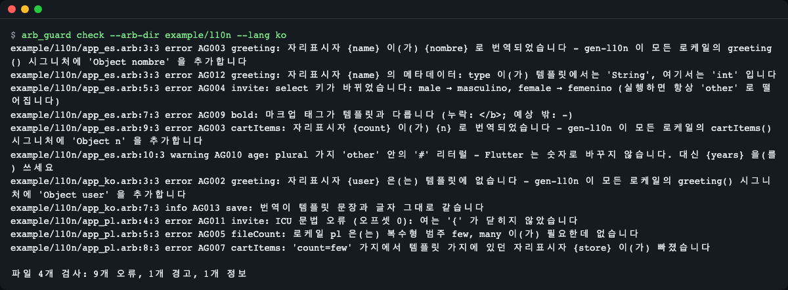
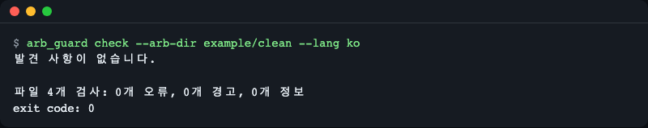
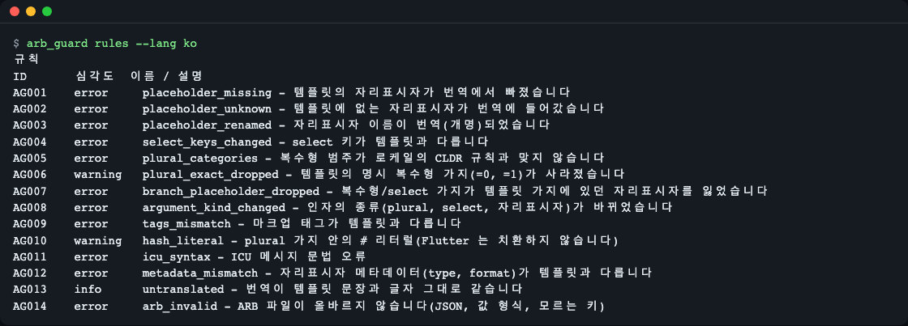
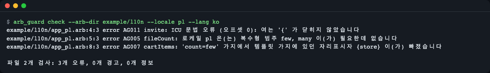
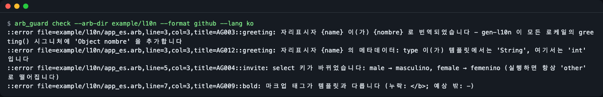

# arb-guard

[English](README.md) | **한국어**

arb-guard 는 번역된 Flutter ARB 파일이 템플릿 파일의 구조(자리표시자 이름, `select` 키, plural 가지, 마크업 태그)를 그대로 지켰는지 검사하는 Dart 명령줄 도구입니다. LLM·기계 번역·외부 번역사가 채운 ARB 파일을 위한 것이며, 번역 자체는 하지 않습니다. CI 에서 `arb_guard check` 를 돌리고, 빌드가 ARB 파일과 먼 곳에서 깨지기 전에 보고된 줄을 고치세요.


*결함이 들어 있는 예제를 검사한 화면: 발견마다 파일, 줄, 열, 규칙 ID 와 쉬운 설명이 붙습니다.*

## 무엇을 잡나

아래 스페인어 번역은 모두 `flutter gen-l10n` 이 종료 코드 0 으로 통과시킵니다(2026-11-15, Flutter 3.32.4 로 측정).

| 템플릿(`app_en.arb`) | 번역(`app_es.arb`) | 무슨 문제가 생기나 |
|---|---|---|
| `Hello, {name}!` | `¡Hola, {nombre}!` | 생성된 API 에 모든 로케일 공통으로 매개변수가 하나 더 붙음 |
| `select, male{…} female{…}` | `select, masculino{…} femenino{…}` | 키는 코드가 넘기는 값이라 앱이 항상 `other` 로 떨어짐 |
| `Welcome <b>{name}</b>` | `Bienvenido <b>{name}` | 닫는 태그가 사라짐 |
| `{count, plural, …}` | `{n, plural, …}` | 개수 변수 이름이 바뀜 |

첫 번째 행의 생성 Dart 코드(이 프로젝트의 조사에서 실제 `gen-l10n` 을 돌려 복사):

```dart
String greeting(String name, Object nombre);
```

`greeting(String name)` 이 `greeting(String name, Object nombre)` 로 바뀌어서, ARB 와 상관없는 호출부에서 컴파일 오류가 납니다([flutter/flutter#163627](https://github.com/flutter/flutter/issues/163627), 2026-11-15 확인).

## 이런 분께

- LLM 이나 번역 서비스로 `app_<locale>.arb` 를 채우고 머지 전에 확인하고 싶은 분
- 폴란드어·한국어를 읽지 못해도 번역 PR 을 검토해야 하는 분
- 구조가 깨지면 파일·줄 번호와 함께 실패하는 CI 단계 하나가 필요한 분

## 설치

Dart SDK(3.7 이상)만 있으면 됩니다. Flutter 는 필요 없습니다. Flutter 를 쓴다면 Dart 가 이미 들어 있고, 아니면 <https://dart.dev/get-dart> 에서 설치하세요.

아직 pub.dev 에 없으므로 GitHub 에서 설치합니다.

```bash
# 방법 1: Flutter/Dart 프로젝트의 dev 의존성으로
dart pub add dev:arb_guard --git-url https://github.com/LeeGyeongPil/arb-guard
dart run arb_guard check

# 방법 2: 전역 설치
dart pub global activate --source git https://github.com/LeeGyeongPil/arb-guard
arb_guard check

# 방법 3: clone 해서 단일 실행 파일로
git clone https://github.com/LeeGyeongPil/arb-guard && cd arb-guard
dart pub get && dart compile exe bin/arb_guard.dart -o arb_guard
```

## 빠르게 시작하기

저장소를 clone 해서 결함이 들어 있는 예제(`example/l10n`)에 실행해 봅니다.

```bash
git clone https://github.com/LeeGyeongPil/arb-guard && cd arb-guard
dart pub get
dart run bin/arb_guard.dart check --arb-dir example/l10n --lang ko
```

출력(앞 4줄과 마지막 줄만; 스크린샷에 전체가 있습니다):

```text
example/l10n/app_es.arb:3:3 error AG003 greeting: 자리표시자 {name} 이(가) {nombre} 로 번역되었습니다 - gen-l10n 이 모든 로케일의 greeting() 시그니처에 'Object nombre' 을 추가합니다
example/l10n/app_es.arb:3:3 error AG012 greeting: 자리표시자 {name} 의 메타데이터: type 이(가) 템플릿에서는 'String', 여기서는 'int' 입니다
example/l10n/app_es.arb:5:3 error AG004 invite: select 키가 바뀌었습니다: male → masculino, female → femenino (실행하면 항상 'other' 로 떨어집니다)
example/l10n/app_es.arb:7:3 error AG009 bold: 마크업 태그가 템플릿과 다릅니다 (누락: </b>; 예상 밖: -)
...
파일 4개 검사: 9개 오류, 1개 경고, 1개 정보
```

오류가 있어서 종료 코드는 1 입니다. 한 줄은 `파일:줄:열 심각도 규칙-ID 키: 설명` 으로 읽습니다(심각도 낱말 error·warning·info 와 규칙 ID 는 한국어 출력에서도 그대로입니다). 줄과 열은 ARB 파일 속 키의 위치입니다.

결함이 없는 폴더 `example/clean` 은 이렇게 나옵니다.

```bash
dart run bin/arb_guard.dart check --arb-dir example/clean --lang ko
```

```text
발견 사항이 없습니다.

파일 4개 검사: 0개 오류, 0개 경고, 0개 정보
```


*깨끗한 예제는 아무것도 보고하지 않고 0 으로 끝납니다.*

내 프로젝트에서는 옵션 없이 `arb_guard check` 만 실행하면 `l10n.yaml` 이 있으면 그것을 읽고, 없으면 `lib/l10n` 과 `app_en.arb` 를 씁니다.

## 사용법

| 명령·옵션 | 하는 일 | 예 |
|---|---|---|
| `check` | 폴더의 모든 `.arb` 를 템플릿과 비교 | `arb_guard check` |
| `--arb-dir DIR` | ARB 파일 폴더 | `--arb-dir lib/l10n` |
| `--template FILE` | 템플릿 파일 이름(기본 `app_en.arb`) | `--template app_en.arb` |
| `--config FILE` | `l10n.yaml` 경로 | `--config l10n.yaml` |
| `--locale es,ko` | 이 로케일만 검사 | `--locale pl` |
| `--format` | `text`(기본), `json`, `sarif`, `github` | `--format sarif` |
| `--output FILE` | 보고서를 파일로 저장 | `--output arb.sarif` |
| `--fail-on` | 종료 코드 1 을 만드는 최저 심각도: `error`(기본), `warning`, `never` | `--fail-on warning` |
| `--use-escaping`, `--relax-syntax` | `l10n.yaml` 의 같은 이름 키와 같은 뜻 | `--relax-syntax` |
| `--no-color` | 색 없는 출력 | |
| `--lang en\|ko` | 출력 언어 | `--lang ko` |
| `rules` | 모든 규칙과 기본 심각도 목록 | `arb_guard rules` |
| `--version` | 버전 출력 | `arb_guard 0.1.3` |

종료 코드: `0` `--fail-on` 이상의 발견 없음, `1` 발견 있음, `2` 사용법 오류(예: 폴더 없음).

### 규칙

`arb_guard rules --lang ko` 는 아래 목록을 한국어로 보여 줍니다.


*`AG001` 부터 `AG014` 까지 14개 규칙과 기본 심각도.*

| ID | 심각도 | 뜻 |
|---|---|---|
| AG001 | error | 템플릿의 자리표시자가 번역에 없음 |
| AG002 | error | 템플릿에 없는 자리표시자를 번역이 사용 |
| AG003 | error | 자리표시자 이름이 바뀜(번역됨) |
| AG004 | error | select 키가 템플릿과 다름 |
| AG005 | error | plural 범주가 해당 로케일의 CLDR 규칙과 맞지 않음 |
| AG006 | warning | 템플릿의 정확 일치 plural 가지(`=0`, `=1`)가 빠짐 |
| AG007 | error | plural/select 가지가 템플릿 가지에 있던 자리표시자를 뺌 |
| AG008 | error | 인자 종류가 바뀜(plural, select, 자리표시자) |
| AG009 | error | 마크업 태그가 템플릿과 다름 |
| AG010 | warning | plural 가지 안의 글자 그대로의 `#`(Flutter 가 숫자로 바꿔 주지 않음) |
| AG011 | error | ICU 메시지 문법 오류 |
| AG012 | error | 자리표시자 메타데이터(type, format)가 템플릿과 다름 |
| AG013 | info | 번역이 템플릿 문장과 똑같음 |
| AG014 | error | ARB 파일이 올바르지 않음(JSON, 값 형식, 알 수 없는 키. 읽을 수 없거나 UTF-8 이 아닌 파일 포함) |

템플릿에서 빠진 자리표시자 N개와 번역에서 새로 생긴 N개가 같으면, 문서 순서대로 짝지어 `AG001`/`AG002` 두 종류 대신 "이름이 바뀜" `AG003` 한 줄로 보고합니다. 개수가 다르면 `AG001`/`AG002` 로 돌아갑니다.

### plural 범주는 언어마다 다릅니다

select 키는 코드가 넘기는 값이라 정확히 비교합니다. plural 범주는 언어 규칙이라서 [CLDR](https://www.unicode.org/cldr/charts/latest/supplemental/language_plural_rules.html)(2026-11-15 확인) 기반의 언어별 표를 씁니다.

| 로케일 | 필수 | 선택 |
|---|---|---|
| `ko`, `ja`, `zh` | `other` | |
| `en`, `de` | `one`, `other` | |
| `es`, `fr`, `it`, `pt` | `one`, `other` | `many` |
| `pl`, `ru`, `uk` | `one`, `few`, `many`, `other` | |

예제 `app_pl.arb` 에는 `few` 와 `many` 가 없습니다.

```bash
dart run bin/arb_guard.dart check --arb-dir example/l10n --locale pl --lang ko
```


*여기서는 폴란드어 파일만 검사했고(`--locale pl`) `AG005` 가 붙습니다. 위의 전체 보고서에는 한국어(`other` 만)와 스페인어(`many` 선택)에 `AG005` 가 없습니다.*

`=1` 같은 정확 일치 가지는 `one` 을, `=0` 은 `zero` 를 충족한 것으로 봅니다. 가지 안에서 개수 변수만 빼는 것(`one{Un archivo}`)은 흔해서 허용하고, 다른 자리표시자를 빼면 `AG007` 입니다.

## CI

arb-guard 는 로컬 파일만 읽으므로 키가 필요 없습니다. GitHub Actions 예:

```yaml
- uses: dart-lang/setup-dart@v1
- run: dart pub get
- run: dart run arb_guard check --format github
```

`--format github` 는 PR 화면에 보이는 워크플로 주석을 출력합니다.


*발견마다 `::error file=…,line=…` 주석 한 줄.*

GitHub 코드 스캐닝에는 SARIF 2.1.0 을 만들어 올립니다. 보고 단계에서는 `--fail-on never` 를 줘야 업로드 단계가 이어서 실행됩니다.

```bash
dart run arb_guard check --format sarif --output arb.sarif --fail-on never
```

`--format json` 은 `version`, `tool`, `ruleId`, `severity`, `locale`, `key`, `file`, `line`, `column`, `message`, `data` 를 가진 `findings` 배열, 그리고 `errors`, `warnings`, `infos`, `filesChecked`, `missingKeys` 를 가진 `summary` 를 줍니다.

이 레포의 CI 는 Ubuntu, Windows, macOS 에서 돕니다.

## 화면 언어

출력은 영어 또는 한국어입니다. 우선순위: `--lang en|ko`, `ARB_GUARD_LANG`, `LC_ALL`, `LC_MESSAGES`, `LANG`. `ko*` 가 아니면 영어입니다. 규칙 ID 와 `error`·`warning`·`info` 낱말은 언어와 상관없이 고정이라 스크립트가 의존해도 됩니다. `json`·`sarif` 의 메시지는 고른 언어를 따릅니다.

```bash
ARB_GUARD_LANG=ko dart run arb_guard check
```

## 라이브러리로 쓰기

번역기가 결과를 돌려준 직후, 저장하기 전에 메모리 안에서 검사할 수 있습니다.

```dart
import 'package:arb_guard/arb_guard.dart';

void main() {
  final findings = checkMessages(
    locale: 'es',
    template: {'greeting': 'Hello, {name}!'},
    translation: {'greeting': '¡Hola, {nombre}!'},
    lang: 'en',
  );
  for (final f in findings) {
    print('${f.ruleId} ${f.severity.name} ${f.key}: ${f.message}');
  }
}
```

```text
AG003 error greeting: placeholder {name} was translated to {nombre} - gen-l10n would add 'Object nombre' to every locale's greeting() signature
```

폴더 전체는 `checkProject(CheckOptions(...))` 로 검사합니다.

## 동작 원리


1. 각 `.arb` 파일을 읽고 모든 키의 줄과 열을 기억합니다.
2. 작은 ICU 파서로 메시지를 분석합니다(자리표시자, `plural`, `select`, `<태그>`).
3. 번역을 템플릿과 비교합니다: 이름, 키, 가지, 태그, 자리표시자 메타데이터.
4. 차이마다 규칙 ID 와 기본 심각도가 붙은 발견이 됩니다.
5. 고른 형식으로 보고서를 출력하고, 종료 코드로 CI 에 알립니다.

## 언제 쓰나

- 잘 맞는 상황: 번역의 구조가 템플릿과 같아야 하고, 번역하는 쪽이 내 앱을 직접 돌려 보지 않는 경우(LLM, 기계 번역, 외주).
- 구조만 검사합니다. 번역 품질·맞춤법·어조는 판단하지 않습니다.
- 문자열 추출·번역은 [arb_translate](https://pub.dev/packages/arb_translate), ARB 에서 Dart 코드 생성은 [Flutter 현지화 안내](https://docs.flutter.dev/ui/accessibility-and-localization/internationalization) 를 보세요. arb-guard 는 둘 중 어느 쪽 뒤에도 붙일 수 있습니다.

## 한계

- ICU 의 일부만 분석합니다. `number`·`date` 서식 인자는 이름만 비교하고 의미는 보지 않습니다.
- ICU 문법 오류의 위치(오프셋)는 이 파서의 정의를 따르며 `gen-l10n` 의 정확한 오프셋과 비교한 것은 아닙니다.
- `use-escaping`·`relax-syntax` 는 명령줄로 켤 수 있지만, `l10n.yaml` 이 켜 둔 것을 명령줄로 끌 수는 없습니다.
- 이번 버전에 없는 것: 기준선(baseline) 파일, 바뀐 파일만 검사, 보호 토큰(숫자·URL), 억제 주석.

## 자주 겪는 문제

| 증상 | 원인 | 해결 |
|---|---|---|
| `arb_guard: ARB folder not found: …`(영어) 또는 한국어 같은 뜻의 오류, 종료 코드 2 | `--arb-dir` 도 `arb-dir` 가 있는 `l10n.yaml` 도 없고 `lib/l10n` 도 없음 | `--arb-dir` 를 주거나 `l10n.yaml` 에 `arb-dir` 추가 |
| 내 컴퓨터에서 출력이 한국어로 나옴 | `LANG` 또는 `ARB_GUARD_LANG` 이 한국어 | `--lang en` 추가 |
| 파일이 엉뚱한 로케일로 보고됨 | 로케일은 `@@locale`, 없으면 파일 이름에서 가져옴 | `@@locale` 을 적거나 `app_<locale>.arb` 로 이름 짓기 |
| `AG014` 와 `invalid_encoding` 이 보고됨 | 파일이 올바른 UTF-8 이 아님(외부 도구가 만든 파일에 흔함) | UTF-8 로 다시 저장 |
| 경고가 있는데 종료 코드가 0 | 기본값이 `--fail-on error` | `--fail-on warning` 사용 |

## 개발

```bash
dart pub get
dart analyze --fatal-infos
dart test
```

`pubspec.yaml` 이 허용하는 가장 낮은 의존성 버전으로 확인하려면(CI 의 `lowest-versions` 작업이 같은 일을 합니다):

```bash
dart pub downgrade
dart analyze --fatal-infos
dart test
```

버그·제안은 이슈로 남겨 주세요. 변경 기록은 [CHANGELOG.md](CHANGELOG.md).

## 라이선스

MIT. [LICENSE](LICENSE) 참고.
