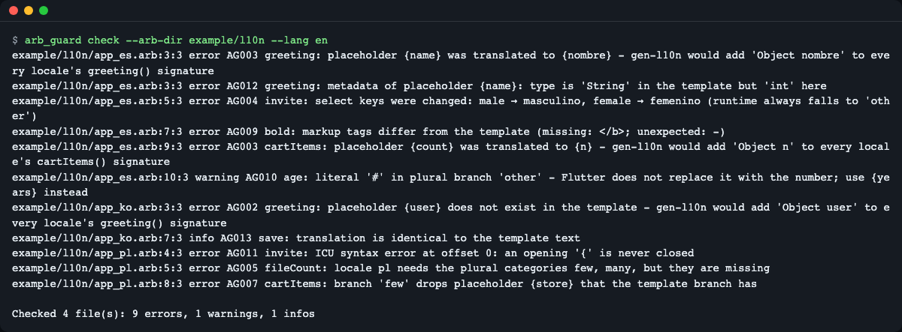
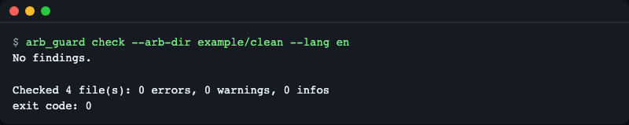
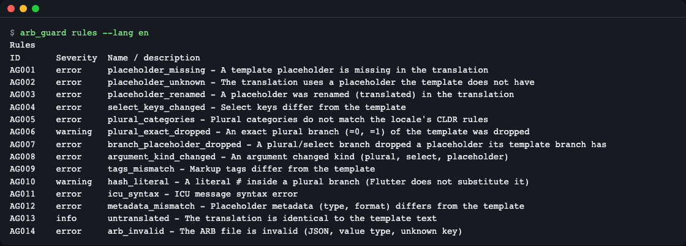
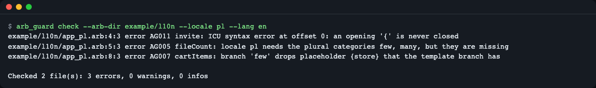
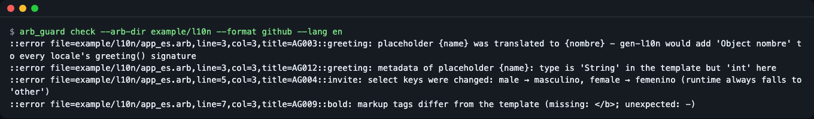
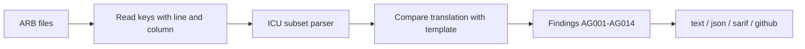

# arb-guard

**English** | [한국어](README.ko.md)

arb-guard is a Dart command line tool that checks whether translated Flutter ARB files kept the structure of the template file: placeholder names, `select` keys, plural branches and markup tags. It is made for ARB files filled in by LLMs, machine translation or outside translators; it never translates anything itself. Run `arb_guard check` in CI and fix the lines it reports before the build breaks somewhere far from the ARB file.


*`arb_guard check` on the bundled defective example: each finding has a file, line, column, rule ID and a plain explanation.*

## What it catches

`flutter gen-l10n` exits with code 0 for all of these Spanish translations (measured with Flutter 3.32.4 on 2026-11-15):

| Template (`app_en.arb`) | Translation (`app_es.arb`) | What goes wrong |
|---|---|---|
| `Hello, {name}!` | `¡Hola, {nombre}!` | The generated API grows an extra parameter for every locale |
| `select, male{…} female{…}` | `select, masculino{…} femenino{…}` | The keys are values your code passes, so the app always falls to `other` |
| `Welcome <b>{name}</b>` | `Bienvenido <b>{name}` | The closing tag is gone |
| `{count, plural, …}` | `{n, plural, …}` | The count variable was renamed |

The generated Dart code for the first row (copied from a real `gen-l10n` run in the probe for this project):

```dart
String greeting(String name, Object nombre);
```

`greeting(String name)` became `greeting(String name, Object nombre)`, so the compile error shows up in a call site that has nothing to do with the ARB file (see [flutter/flutter#163627](https://github.com/flutter/flutter/issues/163627), checked 2026-11-15).

## Who it is for

- You fill `app_<locale>.arb` files with an LLM or a translation service and want a check before merging.
- You review translation pull requests and do not read Polish or Korean.
- You want one CI step that fails on structural damage, with file and line numbers.

## Install

arb-guard needs only the Dart SDK (3.7 or newer). Flutter itself is not required. If you use Flutter, Dart is already included. Otherwise install Dart from <https://dart.dev/get-dart>.

The package is not on pub.dev yet, so install it from GitHub:

```bash
# Option 1: as a dev dependency of your Flutter/Dart project
dart pub add dev:arb_guard --git-url https://github.com/LeeGyeongPil/arb-guard
dart run arb_guard check

# Option 2: globally
dart pub global activate --source git https://github.com/LeeGyeongPil/arb-guard
arb_guard check

# Option 3: a single binary from a clone
git clone https://github.com/LeeGyeongPil/arb-guard && cd arb-guard
dart pub get && dart compile exe bin/arb_guard.dart -o arb_guard
```

## Quick start

Clone the repository and run it on the bundled defective example (`example/l10n`):

```bash
git clone https://github.com/LeeGyeongPil/arb-guard && cd arb-guard
dart pub get
dart run bin/arb_guard.dart check --arb-dir example/l10n --lang en
```

Output (shortened to the first lines; the screenshot above shows the whole report):

```text
example/l10n/app_es.arb:3:3 error AG003 greeting: placeholder {name} was translated to {nombre} - gen-l10n would add 'Object nombre' to every locale's greeting() signature
example/l10n/app_es.arb:3:3 error AG012 greeting: metadata of placeholder {name}: type is 'String' in the template but 'int' here
example/l10n/app_es.arb:5:3 error AG004 invite: select keys were changed: male → masculino, female → femenino (runtime always falls to 'other')
example/l10n/app_es.arb:7:3 error AG009 bold: markup tags differ from the template (missing: </b>; unexpected: -)
...
Checked 4 file(s): 9 errors, 1 warnings, 1 infos
```

The exit code is 1 because there are errors. Read a line as `file:line:column severity rule-ID key: explanation`. The line and column point at the key in the ARB file.

Now the folder without defects, `example/clean`:

```bash
dart run bin/arb_guard.dart check --arb-dir example/clean --lang en
```

```text
No findings.

Checked 4 file(s): 0 errors, 0 warnings, 0 infos
```


*The clean example reports nothing and exits with 0.*

In your own project, `arb_guard check` with no options reads `l10n.yaml` (if present), otherwise it uses `lib/l10n` and `app_en.arb`.

## Usage

| Command / option | What it does | Example |
|---|---|---|
| `check` | Compares every `.arb` file in a folder with the template | `arb_guard check` |
| `--arb-dir DIR` | Folder with the ARB files | `--arb-dir lib/l10n` |
| `--template FILE` | Template file name (default `app_en.arb`) | `--template app_en.arb` |
| `--config FILE` | Path of `l10n.yaml` | `--config l10n.yaml` |
| `--locale es,ko` | Only check these locales | `--locale pl` |
| `--format` | `text` (default), `json`, `sarif`, `github` | `--format sarif` |
| `--output FILE` | Write the report to a file | `--output arb.sarif` |
| `--fail-on` | Lowest severity that gives exit code 1: `error` (default), `warning`, `never` | `--fail-on warning` |
| `--use-escaping`, `--relax-syntax` | Same meaning as the `l10n.yaml` keys | `--relax-syntax` |
| `--no-color` | Plain text output | |
| `--lang en\|ko` | Language of the output | `--lang ko` |
| `rules` | Lists all rules and their default severity | `arb_guard rules` |
| `--version` | Prints the version | `arb_guard 0.1.0` |

Exit codes: `0` nothing at or above `--fail-on`, `1` findings, `2` usage error (for example a missing folder).

### Rules

`arb_guard rules` prints this list:


*The fourteen rules `AG001` to `AG014`, with default severity.*

| ID | Severity | Meaning |
|---|---|---|
| AG001 | error | A template placeholder is missing in the translation |
| AG002 | error | The translation uses a placeholder the template does not have |
| AG003 | error | A placeholder was renamed (translated) |
| AG004 | error | Select keys differ from the template |
| AG005 | error | Plural categories do not match the locale's CLDR rules |
| AG006 | warning | An exact plural branch (`=0`, `=1`) of the template was dropped |
| AG007 | error | A plural/select branch dropped a placeholder its template branch has |
| AG008 | error | An argument changed kind (plural, select, placeholder) |
| AG009 | error | Markup tags differ from the template |
| AG010 | warning | A literal `#` inside a plural branch (Flutter does not substitute it) |
| AG011 | error | ICU message syntax error |
| AG012 | error | Placeholder metadata (type, format) differs from the template |
| AG013 | info | The translation is identical to the template text |
| AG014 | error | The ARB file is invalid (not UTF-8, JSON, value type, unknown key) |

If the template has N placeholders missing and the translation has N unknown ones, arb-guard pairs them in document order and reports one `AG003` "renamed" line instead of separate `AG001`/`AG002` lines. If the counts differ it falls back to `AG001`/`AG002`.

### Plural categories depend on the language

Select keys are values your code passes, so they are compared exactly. Plural categories are language rules, so arb-guard uses a per-language table based on [CLDR](https://www.unicode.org/cldr/charts/latest/supplemental/language_plural_rules.html) (checked 2026-11-15):

| Locale | Required | Optional |
|---|---|---|
| `ko`, `ja`, `zh` | `other` | |
| `en`, `de` | `one`, `other` | |
| `es`, `fr`, `it`, `pt` | `one`, `other` | `many` |
| `pl`, `ru`, `uk` | `one`, `few`, `many`, `other` | |

The example `app_pl.arb` lacks `few` and `many`:

```bash
dart run bin/arb_guard.dart check --arb-dir example/l10n --locale pl --lang en
```


*Only the Polish file is checked here (`--locale pl`), and it gets `AG005`. The full report above shows no `AG005` for Korean (`other` only) or Spanish (`many` optional).*

An exact branch such as `=1` also satisfies `one`, and `=0` satisfies `zero`. Leaving out the count variable inside a branch (`one{Un archivo}`) is common and allowed; dropping any other placeholder is `AG007`.

## CI

arb-guard works offline on local files, so it needs no keys. A GitHub Actions job:

```yaml
- uses: dart-lang/setup-dart@v1
- run: dart pub get
- run: dart run arb_guard check --format github
```

`--format github` prints workflow annotations that show up on the pull request:


*Each finding as a `::error file=…,line=…` annotation.*

For GitHub code scanning, write SARIF 2.1.0 and upload it. Use `--fail-on never` in the report step so the upload step still runs:

```bash
dart run arb_guard check --format sarif --output arb.sarif --fail-on never
```

`--format json` gives `version`, `tool`, a `findings` array with `ruleId`, `severity`, `locale`, `key`, `file`, `line`, `column`, `message`, `data`, and a `summary` with `errors`, `warnings`, `infos`, `filesChecked` and `missingKeys`.

The CI of this repository runs on Ubuntu, Windows and macOS.

## Language

Output is English or Korean. Priority: `--lang en|ko`, then `ARB_GUARD_LANG`, then `LC_ALL`, `LC_MESSAGES`, `LANG`. Anything that is not `ko*` falls back to English. Rule IDs and the words `error`, `warning`, `info` never change, so scripts can rely on them. Messages in `json` and `sarif` follow the chosen language.

```bash
ARB_GUARD_LANG=ko dart run arb_guard check
```

## Library use

Check translations in memory, for example right after a translator returns them and before saving:

```dart
import 'package:arb_guard/arb_guard.dart';

void main() {
  final findings = checkMessages(
    locale: 'es',
    template: {'greeting': 'Hello, {name}!'},
    translation: {'greeting': '¡Hola, {nombre}!'},
    lang: 'en',
  );
  for (final f in findings) {
    print('${f.ruleId} ${f.severity.name} ${f.key}: ${f.message}');
  }
}
```

```text
AG003 error greeting: placeholder {name} was translated to {nombre} - gen-l10n would add 'Object nombre' to every locale's greeting() signature
```

`checkProject(CheckOptions(...))` checks a whole folder.

## How it works



1. It reads each `.arb` file and remembers the line and column of every key.
2. It parses each message with a small ICU parser (placeholders, `plural`, `select`, `<tags>`).
3. It compares each translation with the template: names, keys, branches, tags, placeholder metadata.
4. Every difference becomes a finding with a rule ID and a default severity.
5. The report is printed in the chosen format and the exit code tells CI what to do.

## When to use it

- Good fit: the structure of a translation must match the template, and the translator is not a person who runs your app (LLM, machine translation, an agency).
- It checks structure only. It does not judge translation quality, spelling or tone.
- For extracting and translating strings, see [arb_translate](https://pub.dev/packages/arb_translate). For generating Dart from ARB files, see the [Flutter localization guide](https://docs.flutter.dev/ui/accessibility-and-localization/internationalization). arb-guard can run after either.

## Limitations

- Only a subset of ICU is parsed. `number` and `date` format arguments are compared by name, not by meaning.
- ICU syntax error offsets follow this parser's own definition; they were not checked against the exact offsets of `gen-l10n`.
- `use-escaping` and `relax-syntax` can be turned on from the command line, but not turned off over an `l10n.yaml` that enables them.
- Not included in this version: baseline files, checking only changed files, protected tokens (numbers, URLs) and suppression comments.

## Troubleshooting

| Symptom | Cause | Fix |
|---|---|---|
| `arb_guard: ARB folder not found: …` (exit 2) | No `--arb-dir` and no `l10n.yaml` with `arb-dir`, and `lib/l10n` does not exist | Pass `--arb-dir` or add `arb-dir` to `l10n.yaml` |
| Output is Korean on your machine | `LANG` or `ARB_GUARD_LANG` is set to Korean | Add `--lang en` |
| A file is reported under the wrong locale | The locale comes from `@@locale`, otherwise from the file name | Set `@@locale` or name files `app_<locale>.arb` |
| A file is reported as `AG014` with `invalid_encoding` | The file is not valid UTF-8 (common with files from outside tools) | Re-save it as UTF-8 |
| Exit code 0 although there are warnings | The default is `--fail-on error` | Use `--fail-on warning` |

## Development

```bash
dart pub get
dart analyze --fatal-infos
dart test
```

Bugs and ideas are welcome as issues. Changes are listed in [CHANGELOG.md](CHANGELOG.md).

## License

MIT. See [LICENSE](LICENSE).
